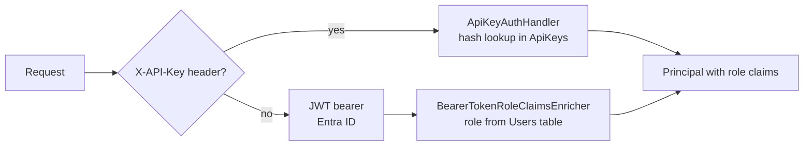

# Authentication and authorization

The server accepts two kinds of caller and treats them alike once they are inside: a person with
an Entra ID token, and a system with an API key. This page explains how a request becomes a
principal with a role, how endpoints ask for that role, and what changes when a solution is
generated with `--auth none`.

## Two schemes behind one selector

`AddApiAuthentication` registers a policy scheme (`DualAuth`) as the default. Its
`ForwardDefaultSelector` looks at the request: an `X-API-Key` header forwards to the API-key
handler; anything else forwards to JWT bearer, configured from the `AzureAd` section through
`Microsoft.Identity.Web`.

The API-key handler hashes the presented key (SHA-256) and looks it up in the `ApiKeys` table by
hash. A match yields a principal named `apikey:{id}` carrying the key's roles and an `auth_type`
claim of `api_key`, which policies can use to exempt or restrict system callers.

## Roles come from the database, not the token

An Entra token proves who the caller is. It says nothing about what they may do here. On
`OnTokenValidated`, `BearerTokenRoleClaimsEnricher.AddApplicationRoleClaimAsync` looks the caller
up in `Users` by email and, when the row exists and `IsActive` is true, adds the stored `Role`
as a standard role claim. No row, or an inactive row, means no role claim: the caller is
authenticated and holds nothing.

This is why the integration tests authenticate through a `TestUser` scheme that fabricates only
the identity and then runs the real enricher against the real table. A test that seeds a Viewer
exercises stored role to claim to policy to endpoint, which a faked principal would skip.

## Three policies

`AddApiAuthorization` registers three policies over the `Roles` enum (`Viewer`, `Editor`, `Admin`):

| Policy | Constant | Admits |
| --- | --- | --- |
| `Api.Read` | `Policies.ReadAccess` | Viewer, Editor, Admin |
| `Api.Write` | `Policies.WriteAccess` | Editor, Admin |
| `Api.Admin` | `Policies.AdminAccess` | Admin |

Every endpoint names its tier: reads `ReadAccess`, writes `WriteAccess`, user management
`AdminAccess`. The feature group's `RequireAuthorization()` is the floor (any authenticated
principal), which only `/Users/me` relies on, so an unprovisioned caller can still learn that they
have no account (`403` with `code: "unprovisioned"`). A new endpoint without a policy is a bug the
Viewer test in its feature's suite should catch.

Production applications extend this at two seams: more policies in `Policies`, and extra claims
added in the enricher (review lanes, per-application access, fine-grained permissions have all
been done this way). The seams are stable; the extensions are per application.

## Configuration

| Key | Meaning |
| --- | --- |
| `AzureAd:Instance` | `https://login.microsoftonline.com/` |
| `AzureAd:TenantId` | The tenant the app registration lives in |
| `AzureAd:ClientId` | The app registration's client id |
| `AzureAd:Audience` | The audience the API expects in tokens |
| `AzureAd:Domain` | The tenant domain |

The app registration is usually owned by IT. Treat its values as fixed, and keep them out of
committed settings files when they are real (the template ships placeholders).

## `--auth none`

A solution generated without authentication has no `Authentication/` or `Authorization/`
folders, no Identity feature or `CRISP.Core.Identity`, and no `Users` or `ApiKeys` tables. Every
endpoint is anonymous. The audit interceptor and stored files record `System` as the actor. On the
client there is no MSAL, no sign-in gate, no user menu, and `useCanWrite()` always answers yes;
the `.noauth` versions of `main.tsx`, `lib/api.ts`, `protected-route.tsx`, `useCurrentUser.ts`
and `top-nav.tsx` are renamed into place at generation time.

Use it for internal tools and prototypes. Anything reachable from outside an office network wants
`entra`.
