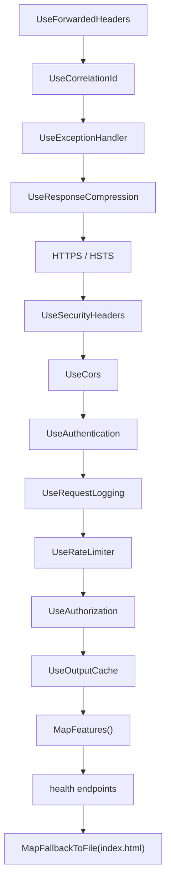

# Architecture

These pages explain how the pieces of a CRISP solution fit together and why. They are
explanations, not tutorials: read them to understand a decision, then go to the code. `Item` is the
worked example throughout, and [Anatomy of a vertical slice](/architecture/vertical-slice/) is
the page to read before adding a feature.

## The rules

Every page below elaborates one or more of these. They are the things an engineer (or an agent)
gets wrong by default.

| Rule | Why |
| --- | --- |
| **No mediator.** Inject the concrete contract (`ICreateService<CreateItem>`) and call `service.Send(...)`. | One indirection fewer, compile-time checked, no runtime dispatch table. |
| **No automatic mapping.** `ToX()` and `ProjectToX()` by hand. | The queryable projection is what EF translates to SQL; a mapper hides what is loaded. |
| **Two types per concept.** Core model is an immutable `record`; Server entity is a mutable `class`. | The model crosses the wire and is generated into TypeScript; the entity carries persistence state. |
| **Validation is FluentValidation only**, run by the group-level endpoint filter. Handlers enforce only rules that need the database. | One place for shape rules; handlers stay about business. |
| **One `RejectedException`, no hierarchy.** Its message is the only one the client sees outside Development. | Framework exceptions carry entity and key names; a type cannot tell a rejection from a fault. |
| **Never set audit or soft-delete fields by hand.** | `AuditLogInterceptor` and `SoftDeleteInterceptor` own them on `SaveChanges`. |
| **Side effects go through the event bus**, not inline in the write handler. | The write commits; the reaction retries on its own. |
| **Tests never use the EF in-memory provider.** | It cannot model query filters, interceptors or provider SQL. Testcontainers plus the real migrations can. |
| **The server never migrates at startup.** | A schema change is a deliberate, logged step with its own exit code. |

## Reading order

1. [Core contracts](/architecture/contracts/): the CQRS primitives every feature inherits from.
2. [Anatomy of a vertical slice](/architecture/vertical-slice/): one feature end to end.
3. [Models and entities](/architecture/models-and-entities/): the two-types rule and the interceptors.
4. [Validation and errors](/architecture/validation-and-errors/): the filter, `RouteIdBinder`, `RejectedException`.
5. [Events](/architecture/events/): the in-process bus.
6. [Authentication](/architecture/authentication/), [Storage](/architecture/storage/), [Security headers](/architecture/security-headers/): the cross-cutting concerns.
7. [Database providers](/architecture/database-providers/), [Client](/architecture/client/), [The template](/architecture/template/): the parts that vary by option.

## How the server is composed

`Program.cs` is short because every concern registers itself through an extension method. The
order matters twice: once when services are registered, once when middleware runs.

Forwarded headers run first so every later component sees the real client address. Authentication
runs before the rate limiter so the limiter can exempt authenticated callers. Authorization runs
after the limiter so an anonymous flood is refused by the cheaper component.

Registration order: database, authentication, authorization, rate limiting, CORS, exception handling
(`AddProblemDetails` and `AddExceptionHandler<GlobalExceptionHandler>`), supporting services
(`HttpContextAccessor`, `TimeProvider.System`, email, storage, events, `AddFeatures()`), API
versioning, FluentValidation, OpenAPI, Kestrel limits, health.
