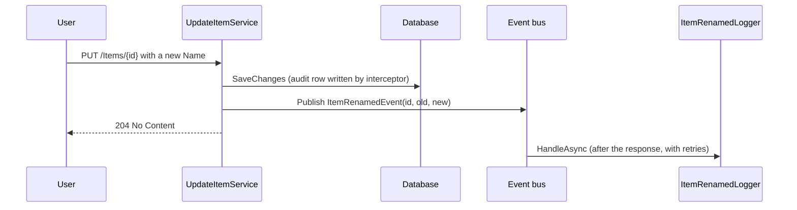

# Items

An item is a named thing the organisation keeps track of. The sample gives it a description, a
free-text owner and an active flag, and that is deliberately all: the point of the slice is to
show every part of the pattern working together, not to model anything real. Replace it with your
first business area; keep its shape.

## What it is

| Field | Meaning | Constraint |
| --- | --- | --- |
| Name | How people refer to it | Required, at most 100 characters, unique across items |
| Description | Free text | Optional, at most 1000 characters |
| Owner | Who is responsible, as typed | Optional, at most 100 characters; existing values drive an autocomplete |
| IsActive | Whether it is in current use | Defaults to true on creation; set on update |
| Files | Attachments in object storage | Any number; see [File storage](/architecture/storage/) |

Every item also carries who created and last changed it and when. Those fields are never set by
hand; the audit interceptor writes them.

## What you can do

| Operation | Route | Who |
| --- | --- | --- |
| List, filtered by name, owner or active state, paged and sorted | `GET /api/v1/Items` | Viewer, Editor, Admin |
| Read one | `GET /api/v1/Items/{id}` | Viewer, Editor, Admin |
| Suggest owner names matching a search term | `GET /api/v1/Items/owners` | Viewer, Editor, Admin |
| See the change history | `GET /api/v1/Items/{id}/activity` | Viewer, Editor, Admin |
| Create | `POST /api/v1/Items` | Editor, Admin |
| Update, including activate or deactivate | `PUT /api/v1/Items/{id}` | Editor, Admin |
| Delete | `DELETE /api/v1/Items/{id}` | Editor, Admin |

Reads carry `Policies.ReadAccess` and writes `Policies.WriteAccess`, named on each endpoint. The
client hides the write controls from a Viewer (`useCanWrite()`), and the server is what refuses:
`403 Forbidden`. A signed-in caller with no `Users` row holds no role and is refused even the
reads. `ItemEndpointTests.Viewer_CanRead_ButCannotWrite` pins this; copy it for every new area.

With `--auth none` every row above reads "anyone".

## Rules

| Rule | Enforced by | Response |
| --- | --- | --- |
| Name is required and at most 100 characters | `CreateItemValidator`, `UpdateItemValidator` | `400` validation problem, per field |
| Description at most 1000, Owner at most 100 | the same validators | `400` validation problem |
| Name is unique | the create and update services, against the database | `409 Conflict`, "Item with name 'X' already exists." |
| The item must exist | read, update and delete services | `404 Not Found`, "Item with ID 'X' not found." |
| A deleted item is gone | soft-delete query filter | It disappears from every list and read; the row stays |
| The id in the route is the id | `RouteIdBinder` in the validation filter | A body id is ignored; the route wins |

Shape rules live in Core so the client receives the same limits in its generated types. Rules
that need the database (uniqueness, existence) live in the service and surface as a
`RejectedException`, which is the only kind of message that reaches a user outside Development.

## What happens afterwards

- Every create, update and delete writes an audit entry (`Describe()` on the entity decides the
  wording); the activity endpoint reads them back newest first.
- Renaming publishes `ItemRenamedEvent`. The sample handler only logs; a real area would notify,
  re-index or synchronise. Handlers run after the write has committed and retry on failure
  (`Events:MaxAttempts`, default 3), so a failing side effect never fails the user's request.
- Deleting is a soft delete. The row keeps its data and its audit trail and is filtered out of
  queries.

## Where it lives

| Side | Path |
| --- | --- |
| Contracts and validators | `src/CRISP.Core/Items/` |
| Endpoints and services | `src/CRISP.Server/Features/Items/` |
| Entity and configuration | `src/CRISP.Server/Data/Entities/ItemEntity.cs`, `Data/Configurations/` |
| Client | `src/CRISP.Client/src/features/items/`, `routes/items.tsx` |
| Tests | `tests/CRISP.Core.Tests/Items/`, `tests/CRISP.Server.Tests/Integration/ItemEndpointTests.cs` |

Generate without it with `--include-sample false`; the tables, routes, pages and tests all go, and
the dashboard starts empty.
