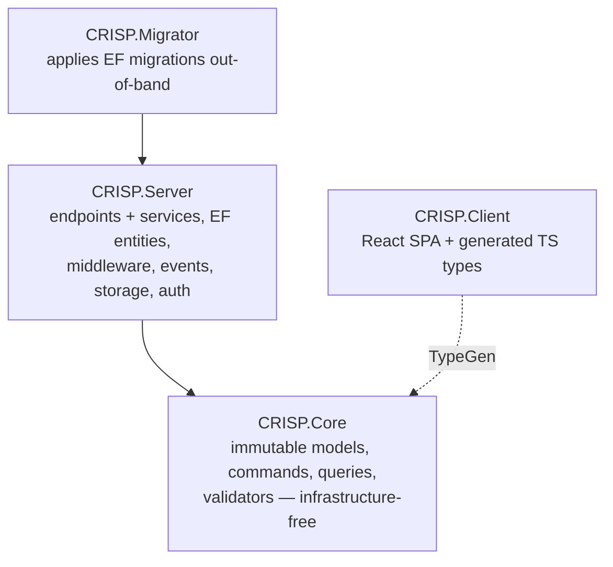

# CRISP architecture

A vertical-slice, CQRS-flavoured ASP.NET Core architecture. Each feature is a self-contained slice
with explicit command/query contracts, **direct service injection (no mediator)**, immutable Core
models, and minimal-API endpoints with the handler service co-located in the same file. `Item` is
the worked example; copy it and rename.

| Project | Responsibility |
| --- | --- |
| `CRISP.Core` | The typed contract: record models, command/query records, FluentValidation validators, shared CQRS primitives. **No EF, no ASP.NET, no providers.** |
| `CRISP.Server` | Everything infrastructural: feature modules (endpoints + services), EF entities and configurations, `DbContext`, interceptors, middleware, the event bus, storage, auth. |
| `CRISP.Client` | React SPA. Consumes types generated from Core on every Core build. |
| `CRISP.Migrator` | Applies EF Core migrations deliberately, never at server startup. Direct connection or SSH bastion. |

There is no separate Infrastructure project; cross-cutting code lives under
`CRISP.Server/{Data,Middleware,Infrastructure,Features}`. `--aspire` adds an AppHost (database
container, Migrator, server and client with the dashboard) and ServiceDefaults (telemetry, service
discovery, resilience) as a development convenience; deployment stays the Dockerfile plus the
Migrator.

## Read by topic

| Doc | Covers |
| --- | --- |
| [contracts.md](contracts.md) | CQRS primitives — `ICommand`, `CreateCommand`/`ModifyCommand`/`DeleteCommand`, `IQuery<T>`, `SingularQuery`/`PagedQuery`, `IQueryService`, `BaseModel`, query defaults |
| [vertical-slice.md](vertical-slice.md) | Slice anatomy — Core records, co-located endpoint + service files, `IFeature` registration and auto-discovery, keyed `DeleteCommand`, route-id updates, per-entity activity |
| [models-and-entities.md](models-and-entities.md) | Core model ↔ Server entity, `ToX()` / `ProjectToX()` mapping, audit and soft-delete interceptors, EF configuration |
| [validation-and-errors.md](validation-and-errors.md) | FluentValidation + `ValidationEndpointFilter` + `RouteIdBinder`; `RejectedException` and the `GlobalExceptionHandler` status map |
| [events.md](events.md) | In-process event bus — `BaseEvent`, `IEventPublisher`, `IEventHandler<T>`, `EventWorker` |
| [storage-auth-types.md](storage-auth-types.md) | Presigned-URL storage and scratch keys, dual-scheme auth and roles, security headers and CSP derivation, TypeGen, pipeline order |
| [testing.md](testing.md) | xUnit v3 / MTP, Testcontainers + Respawn, the `X-Test-User` scheme, how to run |
| [reviews/](reviews/) | Dated decision records. Start with the 2026-09-12 production consolidation review for why things are the way they are. |

## Adding a feature

1. **Core** `Core/<Feature>/`: read model (`record : BaseModel` or `BaseAuditableModel`), commands
   (`: CreateCommand` / `: ModifyCommand`), queries (`: SingularQuery<T>` / `: PagedQuery<T>`). Mark
   every wire contract `[ExportTsInterface]`.
2. **Core**: an `AbstractValidator<T>` beside each user-facing command.
3. **Server** `Data/Entities/`: EF entity (`class : BaseAuditableEntity`) with `ToX()` and
   `IQueryable` `ProjectToX()` mappings, plus an `IEntityTypeConfiguration<T>` in
   `Data/Configurations/`. Add a migration with `dotnet ef migrations add <Name> --project
   src/CRISP.Server --output-dir Data/Migrations` and apply it with the Migrator.
4. **Server** `Features/<Feature>/`: one file per operation — a `static` endpoint class (`Map` +
   `HandleAsync`) with its `internal sealed` service in the same file. Updates map `PUT /{id:guid}`.
   Reject with `RejectedException.NotFound(...)` / `.Conflict(...)`.
5. **Server**: an `IFeature` that registers the services and maps the endpoints under
   `nameof(Model).Pluralize()` with `RequireAuthorization()`, plus
   `GetActivityEndpoint.Map<TEntity>(...)`. Auto-discovered; no central wiring.
6. **Tests**: validator tests in `Core.Tests`; an endpoint suite in `Server.Tests/Integration`
   shaped like `ItemEndpointTests`.
7. **Client**: rebuild Core to regenerate `src/api`; wire the UI.

## Non-negotiable rules

- **No mediator.** Inject the concrete contract and call `service.Send(...)`.
- **No automatic mapping.** `ToX()` / `ProjectToX()` by hand. No AutoMapper.
- **Two types per concept.** Core model = immutable `record`; Server entity = mutable `class`.
- **Validation is FluentValidation only**, run by the group-level filter. Handlers enforce only
  DB-dependent business rules.
- **One `RejectedException`, no hierarchy.** Its message is the only one the client sees outside
  Development; framework exceptions map to a status but their text stays in the log.
- **Never hand-set audit or soft-delete fields.** The interceptors own them on `SaveChanges`.
- **Side effects go through the event bus**, not inline in the write handler.
- **Tests never use the EF in-memory provider.** Testcontainers + Respawn, real migrations.
- **The server never migrates at startup.** The Migrator does, as a deliberate step.
