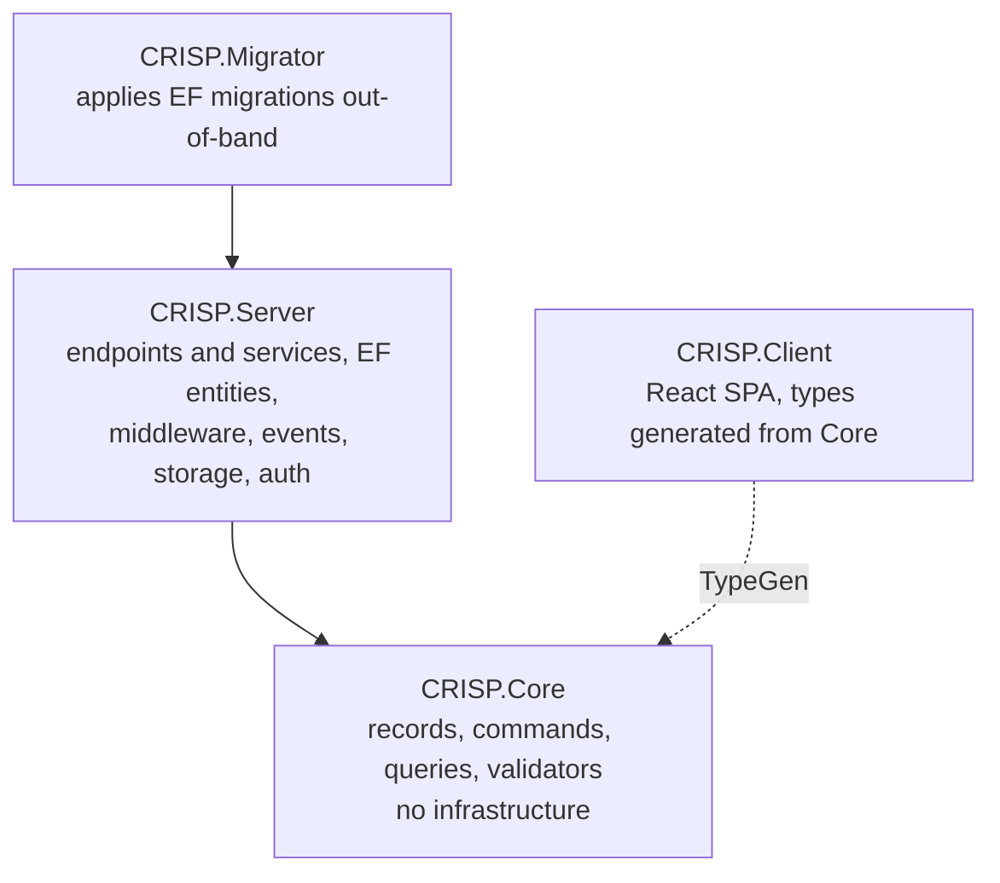

# CRISP

CRISP is a way of building an ASP.NET Core application as a set of self-contained feature slices:
explicit command and query contracts, handler services injected directly into minimal-API
endpoints (no mediator), immutable Core models, and a React client typed from the server's
contracts. `dotnet new crisp` produces a solution in that shape, with authentication, storage,
events, auditing, migrations and tests already wired and already tested.

This site is the documentation for both the pattern and the template. Read it top to bottom once;
after that, each section stands on its own.

::: grids
    ::: grid
        ::: card "Getting started" icon:rocket
        Install the template, generate a solution, run it against a local database, and make your
        first request. [Start here](/getting-started/).
        :::
    :::
    ::: grid
        ::: card "Architecture" icon:layers
        How a slice is built, how models and entities relate, how validation, errors, events,
        storage, authentication and the database providers work. [Architecture](/architecture/).
        :::
    :::
    ::: grid
        ::: card "Domain guides" icon:book-open
        What the business areas do and the rules they enforce, written for the person who owns the
        feature rather than the person who wrote it. [Domain guides](/domain/).
        :::
    :::
    ::: grid
        ::: card "Operations" icon:server
        Running locally, configuration, migrations, tests, CI and deployment. [Operations](/operations/).
        :::
    :::
    ::: grid
        ::: card "Library reference" icon:package
        Every third-party dependency and why it is in the stack, by server, client and tests.
        [Library reference](/reference/).
        :::
    :::
    ::: grid
        ::: card "Design notes" icon:file-clock
        Point-in-time records of decisions as they were made. History, not a living specification.
        [Design notes](/design/).
        :::
    :::
:::

## The shape in one picture

| Project | Owns |
| --- | --- |
| `CRISP.Core` | The typed contract: record models, command and query records, FluentValidation validators, shared CQRS primitives. No EF, no ASP.NET, no providers. |
| `CRISP.Server` | Everything infrastructural: feature modules (endpoints with their services), EF entities and configurations, the `DbContext`, interceptors, middleware, the event bus, storage, authentication. |
| `CRISP.Client` | The React SPA. Consumes TypeScript generated from Core on every Core build. |
| `CRISP.Migrator` | Applies EF Core migrations as a deliberate step. The server never migrates at startup. |

## Where it came from

CRISP was designed once and then iterated on in five production applications. In September 2026
what those applications had learned was consolidated back into this template; the
[production consolidation review](/design/2026-09-12-production-consolidation/) records what was
found, what was adopted and what was deliberately left out.
