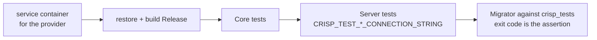

# Continuous integration

Three workflows live in `.github/workflows/`. A generated solution receives the first two; the
third exists only in the template repository.

| Workflow | Trigger | Proves |
| --- | --- | --- |
| `ci.yml` | push to `master`, pull requests, manual | The solution builds warning-free, Core and Server tests pass against a real database, and the Migrator applies the schema to an empty database |
| `ci-client.yml` | the same | The client lints, is formatted, its tests pass and it builds, against types freshly generated from Core |
| `ci-template.yml` (template repo only) | the same, plus tag pushes | Every variant in the smoke matrix generates, builds and tests; packs the `.nupkg` |

## `ci.yml` in detail

- The database is a **service container** (`postgres:16`, `mysql:8.4` or SQL Server 2022) with
  database `crisp_tests`. The integration fixture sees `CRISP_TEST_<PROVIDER>_CONNECTION_STRING` and
  uses it instead of starting Testcontainers, which would need Docker-in-Docker on the runner.
- SQLite needs no service; the tests use a file.
- The Migrator step is not a smoke test of the tool. It is the one place a migration that does not
  apply to an empty schema is caught before a deploy catches it.
- NuGet packages are cached on the hash of `Directory.Packages.props` and every `.csproj`.

## When it is red

| Symptom | Likely cause |
| --- | --- |
| `The integration fixture refuses to run: no migrations` | A variant without a shipped migration; add `InitialCreate` |
| Server tests time out connecting | The service container's health check passed but the port mapping is wrong; compare the `ports:` block to the connection string |
| `429` in integration tests | The factory's rate-limit override was removed; see `CrispServerApplicationFactory` |
| Client job fails on `api/*` imports | The Core build step was removed or reordered; TypeGen runs in the Core build |
| Warnings fail the build | `TreatWarningsAsErrors` is on in `Directory.Build.props`; fix the warning, do not suppress it |

## Adding a job

Keep the shape: one job per deliverable, every step's success defined by an output you can see
(test counts, an exit code, an artefact), never by "it ran". The Migrator step is the model: exit 0
only after re-querying the database.
