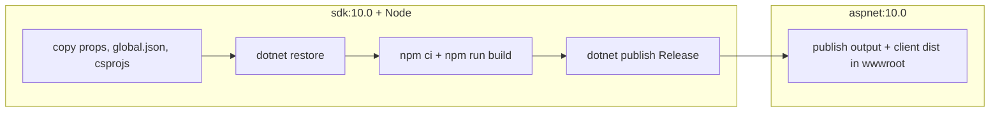
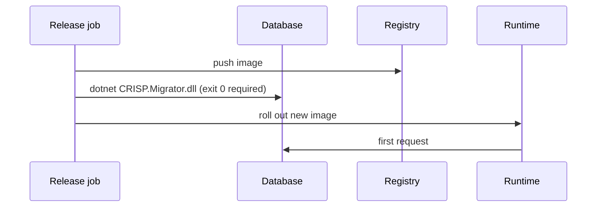

# Deployment

A CRISP solution deploys as one container: the server, serving the API and the built client from
`wwwroot`. The database is migrated by a separate Migrator run before the new image takes traffic.
This page covers the build and the release order; it does not choose a platform for you.

## Prerequisites

- Docker
- A registry to push to
- A database the Migrator can reach from wherever the release step runs (directly, or through a
  bastion)

## Build the image

`src/CRISP.Server/Dockerfile` is a multi-stage build:



```bash
docker build -f src/CRISP.Server/Dockerfile -t crisp-server:$(git rev-parse --short HEAD) .
```

Build from the **repository root**: the Dockerfile copies `Directory.Packages.props`,
`Directory.Build.props` and `global.json` from there, and `.dockerignore` at the root keeps `bin/`,
`obj/`, `node_modules/` and `.git/` out of the context. An API-only solution (`--frontend none`)
receives a Dockerfile without the Node stage.

The image listens on `8080` (`ASPNETCORE_HTTP_PORTS`). Terminate TLS in front of it.

## Release order



1. Push the image.
2. Run the Migrator against the target database with the same assembly version as the image.
   Exit 0 or stop. See [Migrations](/operations/migrations/) for the exit codes and the bastion form.
3. Roll out. Because migrations are additive by convention (rename, do not drop; add nullable, then
   backfill), the previous image keeps working during the rollout.

Do not run the Migrator from inside the server container's entrypoint. It is the one step that
should be able to fail without taking the running service down with it.

## Configure the container

Everything in [Configuration](/operations/configuration/) applies. The ones that are easy to miss
once deployed:

| Setting | Why it bites in production only |
| --- | --- |
| `ConnectionStrings__default` | Development uses the committed file; deployed, the variable must exist |
| `RateLimiting__TrustedProxyNetworks__0` | Behind a load balancer every caller is the balancer's address until this is set; the anonymous limiter then throttles everyone together |
| `SecurityHeaders__ConnectSources__0` | The SPA's CSP is only served from `wwwroot`, never by Vite; any third-party API the browser calls appears blocked for the first time here |
| `Cors__AllowedOrigins__0` | Only when the client is served from a different origin |
| `ObjectStorage__*` | The bucket origin is derived into the CSP; presigned uploads need the bucket's CORS rule to allow `PUT` from the site origin |
| `ASPNETCORE_ENVIRONMENT` | Anything but `Development` hides exception detail and the OpenAPI document |

Health: `/health` and `/healthz` answer without authentication and without touching the database.
Use them for liveness. For readiness of the schema, the Migrator's exit code in the release job is
the signal.

## Aspire

The AppHost is a development tool. Its `dotnet run` orchestrates containers on one machine; it is
not a deployment target. Use the Dockerfile.
