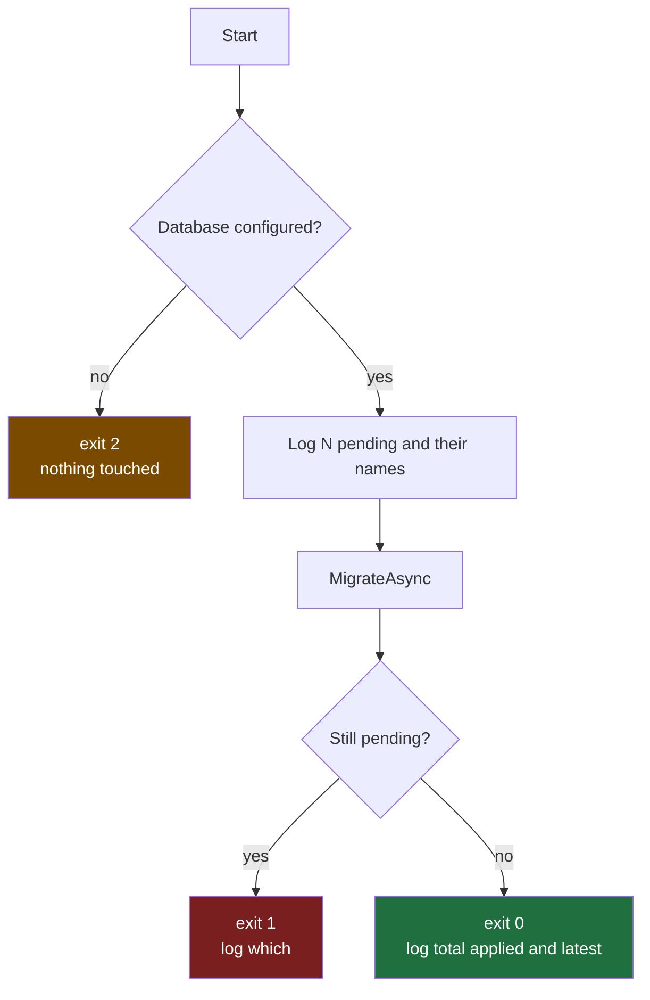

# Migrations

Schema changes are EF Core migrations, applied by `CRISP.Migrator` as a deliberate step. The server
never calls `Migrate()`; a deploy that forgets this step fails loudly on the first query rather
than quietly altering a production schema on boot.

## Prerequisites

- `dotnet tool restore` once per clone (`dotnet-ef` is pinned in `.config/dotnet-tools.json`)
- No database is needed to add a migration: the design-time factory uses a fixed provider
  configuration

## Add a migration

```bash
dotnet ef migrations add <Name> --project src/CRISP.Server --startup-project src/CRISP.Server --output-dir Data/Migrations
```

Review the generated `Up()` before committing. Things to look for:

- A column rename generated as drop-and-add (data loss). Replace with `RenameColumn`.
- A new non-nullable column with no default on a table that has rows.
- Provider-specific types you did not intend (`ObjectKeyColumn` exists precisely so the stored-file
  key column is right on every provider).

A solution generated with a non-default provider, without the sample, or without authentication
ships **no** migration; the first one is `InitialCreate` and the integration fixture refuses to run
until it exists.

## Apply it

::: tabs

== tab "Direct"
```bash
DATABASE_HOST=db.internal DATABASE_PORT=5432 DATABASE_NAME=app DATABASE_USER=app DATABASE_PASSWORD=$DBPASS \
  dotnet run --project src/CRISP.Migrator
```

== tab "Connection string"
```bash
ConnectionStrings__default="Host=db.internal;Database=app;Username=app;Password=${DBPASS};" \
  dotnet run --project src/CRISP.Migrator
```

== tab "Through a bastion"
```bash
BASTION_HOST=bastion.example.com BASTION_USERNAME=ec2-user BASTION_KEY_PATH=~/.ssh/bastion.pem \
DATABASE_HOST=app-db.cluster.rds.amazonaws.com DATABASE_PORT=5432 DATABASE_NAME=app DATABASE_USER=app DATABASE_PASSWORD=$DBPASS \
  dotnet run --project src/CRISP.Migrator
```
The tunnel is opened before EF touches the server and closed on exit. The parts form is required
here so the Migrator knows which host and port to forward.
:::

## Read the result



| Exit | Meaning | Do |
| --- | --- | --- |
| 0 | Applied and re-checked: nothing pending | Proceed with the deploy |
| 1 | `MigrateAsync` returned but the database still reports pending migrations | Stop the deploy; inspect the database's `__EFMigrationsHistory` against the assembly |
| 2 | No target: neither `ConnectionStrings__default` nor the `DATABASE_*` parts were set | Fix the environment; nothing was touched |
| other | Exception: wrong password, host unreachable, SQL error inside a migration | The log names it. A failed migration is rolled back per statement batch by the provider's transaction rules, which differ; check before re-running |

The Migrator does not print the SQL it runs (`Database.Command` is filtered to Warning) so the
summary lines are readable. Run with `Logging__LogLevel__Microsoft.EntityFrameworkCore.Database.Command=Information`
to see them.

## Rolling back

```bash
dotnet ef database update <PreviousMigration> --project src/CRISP.Server --startup-project src/CRISP.Server
```

This runs `Down()` and needs a live connection (`ConnectionStrings__default`). The Migrator has no
rollback mode on purpose: a downgrade in production is a decision, not a deploy step.

## Next steps

- [Deployment](/operations/deployment/) runs the Migrator as a job before the new image starts.
- [Database providers](/architecture/database-providers/) explains what differs per provider.
