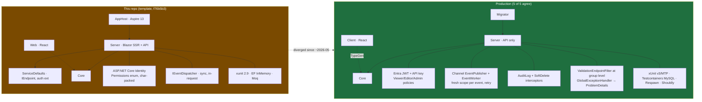

# Production consolidation review

**Date:** 2026-09-12
**Inputs:** `D:\Dev\dotnet\CRISP_Production\*-2026-08-28` (six stripped production snapshots + the
`_claude-crisp` skill/best-practices bundle)
**Method:** every `*.Core` and `*.Server` source file was copied with the project prefix
normalised to `X` (case-sensitive, word-bounded) and diffed against `webapp-starter`, the
canonical reference named by `best_practices/crisp.md`. Whitespace ignored. Migrations excluded.

## 1. The projects

| Snapshot | Prefix | Shape | .cs files | Tests | Notes |
|---|---|---|---|---|---|
| webapp-starter | `AppTemplate` | Core / Server / Client / Migrator | 131 | 23 | Canonical. Has an `Item` slice as the copy-and-rename example |
| WAR-source | `WAR` | Core / Server / Client / Migrator (under `tools/`) | 299 | 34 | Permits workflow. Most mature hardening |
| oic-maintenance | `ACM` | Core / Server / **3** Clients / Migrator | 303 | 58 | Two SPAs in one image, host-routed. Behind an ALB |
| Nucleus | `Nucleus` | Core / Server / Client | 308 | **0** | CPM disabled. Fine-grained permission model |
| Compass-source | `Compass` | Core / **Desktop** / ServiceDefaults / Client | 269 | 44 | Photino desktop app, SQLite. Server code lives in `Compass.Desktop` |
| Modern_Scorpion | `Scorpion` | 9 projects, net461 + netstandard2.0 + net10.0 | 200 | 0 | Legacy migration in flight. Not CRISP-shaped; excluded from the diff |

All five CRISP projects: .NET 10 (`global.json` 10.0.300), Vite + React 19 + Tailwind 4 + shadcn
client, TypeGen 7, FluentValidation 12.1.1, xUnit v3 on MTP (`xunit.v3.mtp-v2`), Shouldly,
Testcontainers.MySql + Respawn (where tests exist), MySQL via `Microting.EntityFrameworkCore.MySql`
(webapp-starter still on Pomelo 9.0.0).

## 2. Template vs production: the shape has moved

Things production has that the template does not, and that **every** production project carries
identically (zero or cosmetic drift across five copies):

| Area | Files | Drift across 5 projects |
|---|---|---|
| CQRS primitives | `Core/Common/{Commands,Queries,BaseModel,PagedResponse,BaseValidator,AutoComplete}.cs`, `Core/Constants/{Query,ClaimNames}.cs` | none (Compass: using-order only) |
| Feature discovery | `Server/Features/{IFeature,FeatureExtensions}.cs` | none (Compass: desktop host variant, +15 lines) |
| Event bus | `Server/Infrastructure/Events/{EventPublisher,EventWorker,EventWorkerOptions,EventServiceCollectionExtensions}.cs`, `Server/Common/Events.cs` | none (Compass renamed two private statics) |
| Interceptors | `Server/Data/Interceptors/{AuditLogInterceptor,SoftDeleteInterceptor}.cs` | AuditLog: two real fixes (section 3) |
| Pipeline | `Server/Middleware/{CorrelationId,RequestLogging,GlobalExceptionHandler,ValidationEndpointFilter,RateLimiting,OpenApiSecurityTransformer}.cs` | real fixes in WAR/ACM (section 3) |
| Auth | `Server/Authentication/{ApiKeyAuthHandler,ApiKeyAuthOptions,AuthenticationExtensions,BearerTokenRoleClaimsEnricher}.cs`, `Server/Authorization/{Policies,AuthorizationExtensions}.cs` | enricher extended 3 ways (section 4) |
| Storage / email | `Server/Common/{Storage,ObjectStorageKey,Emails}.cs`, `Server/Infrastructure/{Storage,Email}/*` | WAR extended `IObjectStorage` (section 3) |

The framework layer is stable. That is the good news: it is a library waiting to be extracted,
and the template should ship it rather than the current `ServiceDefaults`.

## 3. Fixes made in production that never reached the canonical

Ordered by how many projects independently carry the change. Two or more means it was propagated
by hand, which is exactly the signal that it belongs in the template.

| # | Finding | Where | Why it matters |
|---|---|---|---|
| 1 | **`AuditLogInterceptor` skips the empty "Modified X with" row** when only a concurrency token changed | WAR, ACM (identical) | Noise rows in the activity log after every stock op |
| 2 | **`SystemMessageEntity.CreatedOn` → `Timestamp`, `Content` split on newline** into `string[]` for the client | WAR, ACM (identical) | Client renders multi-line audit messages; interceptor sets `Timestamp` |
| 3 | **Self-signed in-memory TLS cert on the ALB leg** (`SelfSignedCertificate.CreateForTls()` in Kestrel config, non-dev only) | WAR, ACM, Nucleus (identical) | AWS Security Hub target-group encryption controls; keeps root FS read-only |
| 4 | **`app.MapStaticAssets()` removed** — throws "static resources manifest file was not found" at startup when the SPA is copied into `wwwroot` by the Dockerfile | WAR, ACM | The canonical still calls it. Latent startup crash in any Docker deployment |
| 5 | **`AddOutputCache()` / `UseOutputCache()`** after auth | WAR, ACM | Template already uses output caching; production confirms placement |
| 6 | **`IQueryableExtensions` moved to `X.Core.Extensions` namespace** | WAR, Nucleus | Was in `X.Core` root |
| 7 | **`GlobalExceptionHandler` returns `Detail` for expected exceptions in production** (`IsExpected` flag on the 4 mapped types; stack trace stays dev-only) | WAR | Users got a bare "Conflict" with no actionable text outside dev |
| 8 | **`RouteIdBinder`** — copies `Guid` route values onto the bound command *before* validation; `ValidationEndpointFilter` calls it | WAR | Clients had to repeat the id in the body or get a confusing 400. **Same problem this repo just solved differently** with `[FromRoute] Guid id` + constructing the command in the handler (commit `ee73d89`). Two implementations of one idea; pick one |
| 9 | **`AuditLogInterceptor.Describe()`** renders collections and byte arrays instead of `System.Collections.Generic.List\`1[...]` | ACM | Any JSON-converted `List<string>` property logged its type name |
| 10 | **`SecurityHeadersMiddleware` rebuilt**: CSP derived from `ObjectStorageOptions` (storage origin for `connect-src` + `img-src`), `worker-src 'self' blob:`, `'wasm-unsafe-eval'`, `data:` and `blob:` in `img-src`, configurable `Csp:ConnectSources`, `camera=(self)` | WAR (fullest), ACM (`IOptions<T>` variant, hardcodes a Nucleus origin), Compass (WAR copy with storage commented out) | Three rewrites of the same file. Consolidate on WAR's derivation + ACM's `IOptions<ObjectStorageOptions>` binding, make `Permissions-Policy` grants configurable |
| 11 | **Per-IP rate limiter exempts authenticated traffic** (`ResolvePerIpPartitionKey`, pure and testable) | ACM | Everyone behind one NAT or ALB shared a single bucket; second user's print run hit 429 |
| 12 | **`TrustedProxyExtensions.AddForwardedHeaders`** — honour `X-Forwarded-For` only from configured CIDRs; `ForwardedHeaders.None` when nothing is configured | ACM | With both lists empty the framework middleware trusts *any* caller. Default-off is the only safe default |
| 13 | **`IObjectStorage.CopyAsync` / `GetObjectMetadataAsync` / `DownloadAsync`**, `StoredObject` record, **`ScratchKeys`** (user-namespaced scratch prefix, server re-derives and normalises before trusting a client-supplied key) | WAR | Attachment records cannot describe bytes that don't exist; stolen keys can't be attached |
| 14 | **`Describe`-style options validation with `ValidateOnStart()`** for every options class | ACM | Fail at boot, not on first request |
| 15 | **Permission claim format**: comma-separated enum names, `AccessAll` satisfies all checks | Nucleus (`PermissionClaims`) | Nucleus explicitly calls this repo's `(char)permission` packing "the legacy UTF-16 char-packing" it replaced. `CRISP.Core/Identity/PermissionsExtensions.cs` still does it |
| 16 | **`BaseStateMachine<TEntity,TState,TTrigger>`** over the `Stateless` package + `StateTransitionException` → 400 | Nucleus (base class), WAR (`PermitStateMachine`, raw Stateless) | Both use Stateless; Nucleus factored the base. Candidate for the framework layer |
| 17 | **`SqliteForeignKeyInterceptor`** | Compass | Only needed for SQLite; ship behind the `--database sqlite` option |

## 4. Project-specific extensions (leave out, but keep the hook)

These all hang off the same two seams, which proves the seams are right:

- `BearerTokenRoleClaimsEnricher` extended three ways: WAR adds review-lane role claims
  (`ReviewerDuties` flags), ACM adds one `app` claim per `ClientApp`, Nucleus adds the packed
  permissions claim. The hook (query the local user, add claims) is stable; the template should
  expose it as a single overridable step rather than a file to edit.
- `Policies` / `AuthorizationExtensions`: every project keeps `Api.Read` / `Api.Write` /
  `Api.Admin` on `Viewer` / `Editor` / `Admin` and appends project policies after.
- `UserEntity`: all five differ, all five add columns after the same base.
- ACM: `ClientApps` host-routed multi-SPA hosting, `SiteClock`, QR/code generation,
  `StorageCapitalFlagInterceptor`. WAR: `QrPayload`. Nucleus: `SMS` (SNS sender), `Tag`,
  `ITenantEntity`. Compass: `Themes`, Photino host, Serilog.

## 5. Decisions the consolidation needs (not findings, choices)

| Decision | Template today | Production (5/5) | Recommendation |
|---|---|---|---|
| Endpoint contract | `IEndpoint` with C# 11 static abstract `MapEndpoint` + `ICommandEndpoint<T>.Handle(...)` | `static class XEndpoint { Map(this RouteGroupBuilder); HandleAsync(...) }` with the `internal sealed` service co-located in the same file | Adopt production. The static-abstract contract was already being loosened here (`CompleteTodoEndpoint : IEndpoint` in `ee73d89`), and production never adopted it. One file per operation, endpoint + service together, is what five teams converged on |
| Route ids | `[FromRoute] Guid id` + construct command in handler (this repo, `ee73d89`) | `RouteIdBinder` in the validation filter (WAR) | `RouteIdBinder`: it runs before validation so the validated value is the used value, and handlers stay one line |
| Orchestration | Aspire 13 AppHost + ServiceDefaults | none; Docker image behind an ALB; `Migrator` console applies EF migrations | Keep `--aspire` as an option but default **off**. Fold the surviving ServiceDefaults content (OpenTelemetry, health checks, service discovery) into `Server/Infrastructure/` so the project count is 4, matching production |
| Auth | ASP.NET Core Identity (cookie + Blazor account pages) | Entra JWT (`Microsoft.Identity.Web`) + API key, `BearerTokenRoleClaimsEnricher` | Production stack as default. Keep Identity behind `--auth identity` only if a public-facing product needs it; otherwise drop the Blazor account UI entirely |
| UI | Blazor SSR *and* React | React SPA only (`MapFallbackToFile`) | Drop Blazor from the template. None of six projects use it |
| Database | Postgres default, SQL Server option | MySQL (Microting provider 10.0.10) on 4/5, SQLite on Compass | Add `mysql` as an option, keep `postgres` default unless NF standardises on MySQL. Note webapp-starter is still on Pomelo 9.0.0; everyone else moved |
| Tests | xunit 2.9.2 + EF InMemory + Moq + FluentAssertions | xUnit v3 `mtp-v2` 4.0.0 + Testcontainers.MySql + Respawn + Shouldly + AutoFixture.Xunit3; `IntegrationTestFixture` + `*ServerApplicationFactory` + `FakeServices` | Production stack. The skill's rule "never EF in-memory" exists because of bugs the in-memory provider hid. The 55 tests committed today are all in-memory |
| Permissions | `Permissions` enum, `(char)` packed claim, `PermissionAuthorizationHandler` with DB fallback | Coarse `Viewer/Editor/Admin` roles everywhere; Nucleus adds `Permission` + `PermissionRole` + `RolePermissions.Resolve` with comma-packed claim | Two tiers: coarse roles as the default (what 5/5 use), Nucleus's fine-grained model as an opt-in layer. Replace char packing either way |
| Error signalling | Throw framework exceptions; handler maps type → status | Same, plus WAR's `IsExpected` echoing framework messages | **Decided (B):** one `RejectedException` with `BadRequest/Forbidden/NotFound/Conflict` factories is the only type whose message reaches the client. No hierarchy. The skill rule "no custom exception types" becomes "one `RejectedException`, no hierarchy" |
| Events | `IEventDispatcher` + `LocalEventDispatcher` (synchronous, in the request) | `IEventPublisher` → bounded `Channel` → `EventWorker` `BackgroundService`, fresh scope per event, retry with backoff | Production. Synchronous dispatch inside the request is the thing the bus was built to avoid |

## 6. `origin/modernization_update` is the baseline

Brock pointed out (2026-09-12) that the July branch already did most of section 2. Verified: its
94 `Core`/`Server` files diff against `webapp-starter` by **+~250 / −~130 lines**, and the
difference is mostly section 3 findings already applied plus the `Item` sample and `Audit` feature
removed. It is the production shape in CRISP namespaces. Steps 1, 3, 4, 5 and 7 of the original
plan are therefore already done on that branch. What it still lacks:

| # | Finding | On branch? | Note |
|---|---|---|---|
| 1 | AuditLog skips empty rows | yes | WAR variant |
| 2 | `SystemMessage.Timestamp` + split content | yes | |
| 3 | Self-signed TLS on ALB leg | yes | |
| 4 | `MapStaticAssets()` removed | yes | Comment was copied from ACM and still talks about "both SPAs" and `UseClientApps`; rewrite it |
| 5 | Output caching | **done** 170e395 | `app.UseOutputCache()` present, `builder.Services.AddOutputCache()` **missing**. Throws at startup. The branch was never booted |
| 6 | `IQueryableExtensions` namespace | yes | |
| 7 | `GlobalExceptionHandler.IsExpected` | **done** 917fe88, then **revised**: only `RejectedException` messages are returned; framework types keep their status but `Detail` is dev-only (EF/LINQ throw the same types with entity and key names). Decision B, Brock 2026-09-12 | |
| 8 | `RouteIdBinder` | **done** 8dc7bcb | |
| 9 | `AuditLogInterceptor.Describe()` | **done** 7a9222d | |
| 10 | `SecurityHeadersMiddleware` rebuild | **done** 6ea86af | has `camera=(self)` + `'wasm-unsafe-eval'` only; no storage-origin derivation, no `worker-src`, no `Csp:ConnectSources` |
| 11 | Rate limiter exempts authenticated | **done** 82ab0d6 | |
| 12 | `AddForwardedHeaders` | **done** c027c89 | |
| 13 | `IObjectStorage` Copy/Metadata + `ScratchKeys` | **done** 7be9975 | `DownloadAsync` only |
| 14 | `ValidateOnStart()` on options | yes | Email, Events, Storage |
| 15 | Permission claim format | n/a | Branch has coarse `Role` only, no `Permissions` enum; the char-packing is gone with it |
| 16 | `BaseStateMachine` | no | |
| 17 | `SqliteForeignKeyInterceptor` | no | |

Also missing from the branch, relative to what the template needs:

- **The sample slice.** `Item` (Core + Server + `ItemConfiguration` + `ItemEvents` +
  `ItemRenamedLogger`) was dropped and nothing replaced it. The template must ship one worked
  slice; the skill is built around copying it.
- **`Features/Audit`** (`AuditFeature`, `GetMessagesEndpoint`) — dropped; only a root-level
  `GetActivityEndpoint` remains. Pick one.
- **`ApplicationDbContextFactory`** (design-time factory) and the **`Migrator`** project.
- **`Server.Tests`** entirely. `Core.Tests` exists (4 files, xUnit v3 + Shouldly, correct
  stack). No `IntegrationTestFixture`, no `ServerApplicationFactory`, no `FakeServices`.
- **`templates/CRISP/`**, `CRISP.Templates.csproj`, `template.json`, `Directory.Build.props`,
  `.editorconfig`, `docs/`. The `dotnet new` packaging is gone; the README still describes the
  old options.
- **Package versions** are webapp-starter's (Pomelo 9.0.0, `xunit.v3.mtp-v2` 3.2.2,
  `Identity.Web` 4.9.0, `Asp.Versioning` 10.0.0); the four newer projects all moved on.

## 7. Consolidation plan (steps, not dates)

Branch off `origin/modernization_update`, not `master`. `master`'s `src/` is the pre-production
shape and is superseded; its `templates/`, `docs/`, `.editorconfig`, `Directory.Build.props` and
today's `tests/CRISP.Server.Tests` are what gets carried forward.

1. **Boot it.** ✅ 2026-09-12 (`f81bb94`..`e192974`). `dotnet build` + `dotnet run` the branch as-is. Fix `AddOutputCache()` (#5) and
   anything else that only shows up when it runs. A branch that has never started is a comment.
2. **Restore the sample slice** ✅ `f4eae99` as `Item` from webapp-starter (it is the one the skill documents)
   and re-add `Features/Audit`. Decide `GetActivityEndpoint` vs `GetMessagesEndpoint`; keep one.
3. **Apply the remaining section 3 findings** ✅ 2026-09-12 (#16 and #17 still pending behind options), one commit each, each with a test that fails
   when the fix is reverted: #7, #8, #9, #10 (full), #11, #12, #13. #16 and #17 go behind
   options.
4. **Add `Migrator`** ✅ `eab5fbd` and `ApplicationDbContextFactory` from webapp-starter. Regenerate
   migrations for the chosen default provider.
5. **Add `Server.Tests`** ✅ `ffd5c92` (21 integration + 97 unit; the 55 in-memory tests were not
   ported file-by-file: their Todo/Identity behaviour is covered by the new Item/Identity suites
   against MySQL, and the authz/eventing tests went with the code they tested) on the production stack (`IntegrationTestFixture` +
   `ServerApplicationFactory` + `FakeServices` from webapp-starter/ACM, Testcontainers + Respawn).
   Port the 55 in-memory tests from `feat/authz-eventing-tests` where they still apply
   (Identity and Todo→Item endpoint tests; drop the `PermissionAuthorizationHandler` and
   `LocalEventDispatcher` tests with the code they tested).
6. **Bring `templates/CRISP/` back** ✅ `ceecb32`, but not as a mirror: the repository root is the template content. Options shipped: `--frontend react|none`, `--skip-restore`. `--include-sample`, `--database`, `--auth`, `--aspire` deliberately not offered (see section 9). Originally: regenerated from the new `src/` shape.
   `template.json` options: `--database postgres|mysql|sqlserver|sqlite`,
   `--auth entra|identity|none`, `--aspire` (default off, adds AppHost + ServiceDefaults back),
   `--include-sample`. Drop `--frontend blazor`, `--redis`. `TemplateSmokeTests` must instantiate
   every option combination and build it.
7. **Carry forward from `master`** ✅ `64f6d6f` `3af116b` (docs were rewritten rather than carried, see step 8; CI replaced): `docs/`, `.editorconfig`, `Directory.Build.props`,
   `CRISP.Templates.csproj`, the `.github/workflows/ci-cd.yml` .NET 10 bump. Carry forward from
   the branch: `.gitattributes`, `.dockerignore`.
8. **Bring `_claude-crisp/skills/crisp-architecture` into the repo** ✅ `9a8ae01` (`.claude/skills/`; its `templates/` copy dropped, it points at `docs/` and `src/`) and
   point its `templates/` at the real files so the skill cannot drift from the code. Same for
   `best_practices/crisp.md` → `docs/`.
9. **Version bumps** ✅ `7cb7e81` (EF Core 10.0.11 + Microting in `9efed51`): `Asp.Versioning.Http` 10.2.2, `Microsoft.Identity.Web`
   4.14.2, `AWSSDK.*` 4.0.102.x, `Testcontainers.MySql` 4.14.0, `xunit.v3.mtp-v2` 4.0.0,
   `Humanizer.Core` 3.0.10, `Microting.EntityFrameworkCore.MySql` 10.0.10 (replacing Pomelo
   9.0.0), OpenTelemetry 1.17.0.
10. **Merge to `master`** and tag — pending, Brock's call. Branch `modernize` is 26 commits over `origin/modernization_update`, not pushed. The `feat/authz-eventing-tests` branch is then obsolete
    except as the source of the ported tests; delete it after step 5.

## 8. What was *not* reviewed

- Feature code (`Features/<Domain>/*`) beyond the `Item` slice: 1,100+ files, project-specific.
- Client code beyond `package.json`.
- Migrations.
- Modern_Scorpion entirely.
- Whether WAR's `RouteIdBinder` has a test that fails when removed. Check before adopting.

## 9. Deferred on purpose (2026-09-12)

| Item | Why not now | What it would take |
| --- | --- | --- |
| `--include-sample false` | The client's router, nav, dashboard and upload hook are all Item-coupled; the real workflow is copy-the-slice-then-delete, which the skill describes | `//#if (IncludeSample)` in `routes/index.tsx`, `top-nav.tsx`, a neutral `dashboard.tsx`, exclude `features/items`, `features/storage/useUploadFile.ts`, `routes/item*`, the Item server files, the migration; a third template smoke variant |
| `--database postgres\|sqlserver\|sqlite` | 5/5 production apps are MySQL; nothing else is verified here | Provider-conditional `DataCollectionExtensions`, per-provider migrations, Testcontainers variants, `SqliteForeignKeyInterceptor` (#17) |
| `--auth identity\|none` | 5/5 are Entra + API key | Master's Identity code is the old shape (Blazor account pages); would need rewriting as a feature |
| `--aspire` | 0/5 use it | AppHost + ServiceDefaults as opt-in projects |
| #16 `BaseStateMachine` over Stateless | Two of five use it; belongs with a sample that has a lifecycle | Port Nucleus's base + `StateTransitionException` → `RejectedException.Conflict`, give the sample a status |
| Client tests | `vitest run --passWithNoTests` passes with zero tests: a check that cannot fail | Component tests for the Item routes |
| `Microsoft.VisualStudio.Azure.Containers.Tools.Targets`, `AutoFixture.Xunit3`, `coverlet.collector` | Pinned but unused | Remove or use |
